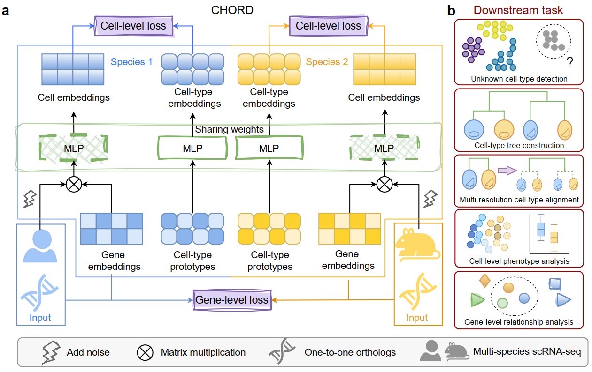

# CHORD

## ✨ Introduction

`CHORD` (Cross-species Hierarchical Orthologous Relationship Discovery) is a cross-species integration framework for joint representation learning across gene, cell and cell-type levels.



## 🛠️ Installation

Install CHORD from source:

```bash
pip install -e .
```

To verify that the installation was successful, run:

```bash
python -m chord.run_training --help
```

## 📘 Usage

### Preparation

Before running CHORD, prepare the following:

- one `.h5ad` file for each species
- homology `.csv` files for all required species pairs
- a YAML config file with the correct input and output paths

### Dataset Format

Each input dataset must be provided as an `.h5ad` file.

Requirements:
- `adata.X` should contain the gene expression matrix in `cells × genes` format.
- `adata.var_names` should contain gene names used for homolog matching.
- `adata.obs` must contain a cell-type annotation column specified by `label_col` in the config file.

Notes:
- CHORD currently reads one `.h5ad` file per species.
- If `is_preprocessed: false`, CHORD will perform basic filtering, library-size normalization, log1p transformation, and HVG selection.
- If `is_preprocessed: true`, the input is assumed to be already preprocessed, but HVG selection is still applied in the current pipeline.

### Homology File Format

Each homology file must be a `.csv` file describing gene matches between a pair of species.

Requirements:
- The file must contain two columns named exactly:
  - `{species1}_gene`
  - `{species2}_gene`
- Here, `species1` and `species2` must match the species names defined in the config file.

Example:
```csv
human_gene,mouse_gene
ALB,Alb
TTR,Ttr
APOE,Apoe
```

Notes:
- CHORD keeps only homolog pairs whose genes are present in the corresponding input datasets.
- For multi-species training, homology files must be provided for all species pairs.


### Configuration

Before running training, update the paths in the YAML config file.

You mainly need to modify:
- `data.species[].h5ad`: path to each species `.h5ad` file
- `data.homology[].path`: path to each homology `.csv` file
- `output.outdir`: directory for saving outputs

Example:

```yaml
data:
  species:
    - name: human
      h5ad: /path/to/human.h5ad
      label_col: cell_type
      is_preprocessed: true

    - name: mouse
      h5ad: /path/to/mouse.h5ad
      label_col: cell_type
      is_preprocessed: true

  homology:
    - species1: human
      species2: mouse
      path: /path/to/human_mouse_homology.csv

output:
  outdir: /path/to/output_dir
```

### Run Training

Run the full CHORD training pipeline with:

```bash
python -m chord.run_training --config /path/to/config.yaml
```

### Output Files

After training, CHORD saves the following outputs to `output.outdir`:

- `best_model.pth`: best model checkpoint
- `stage2_proto_history.npy`: prototype history recorded in stage 2
- `adata_cell_embeddings.h5ad`: cell and cell-type embeddings
- `adata_gene_embeddings.h5ad`: gene embeddings

### Downstream Analysis

After training, you can use the analysis notebook to explore CHORD results. The notebook loads saved cell and gene embeddings from `output.outdir` for downstream analyses.